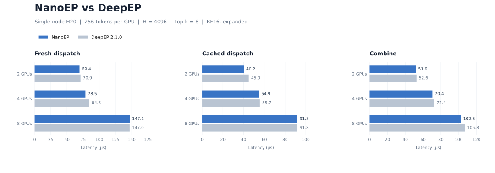

# NanoEP

Single-node expert-parallel dispatch and combine for PyTorch, using CUDA IPC and peer GPU memory access.

- BF16 EP payloads, compact and expert-major expanded layouts.
- Cached routing handles, optional weight payloads, and asynchronous operations.
- Geometry-specialized CUDA kernels with cooperative communication barriers.
- Minimal by design: readable CUDA kernels without NVSHMEM or NCCL Gin.

## Performance



## Install and build

Requires Linux, Python 3.11+, CUDA-enabled PyTorch 2.10+, Ninja, a C++20 toolchain with `std::format` (for example GCC 13+), the elfutils development headers (`libdw-dev` on Ubuntu), and NVCC 12.9+ compatible with PyTorch. Target: Hopper/SM90 GPUs with pairwise CUDA peer access. Multi-node communication and automatic autograd are currently not supported.

Install a CUDA build of PyTorch appropriate for your system, then run from this checkout:

```bash
git submodule update --init --recursive
python -m pip install .
TORCH_CUDA_ARCH_LIST=9.0 python -m nano_ep.build
```

Installation packages the CUDA sources. The host extension builds once through PyTorch. DeepJIT compiles the requested CUDA kernel variants on first use.
DeepJIT is pinned as a Git submodule; source distributions and wheels include its required headers.
Initialize the submodule before building from a checkout. Git archives do not include submodule contents; use the source distribution for a self-contained archive.
Set `NANO_EP_JIT_CACHE_DIR` to reuse their CUBINs across runs. For cold measurements, point it at a fresh directory. DeepEP, NVSHMEM and NCCL Gin are not required.

To build distributable source and wheel packages:

```bash
python -m pip install build
python -m build
```

## Python API

Save the following as `example.py`, then run `torchrun --standalone --nproc-per-node=2 example.py` (one process per GPU):

```python
import os
import torch
import torch.distributed as dist
from nano_ep import CudaBuffer, EPConfig

torch.cuda.set_device(int(os.environ["LOCAL_RANK"]))
dist.init_process_group("gloo")
try:
    rank, size = dist.get_rank(), dist.get_world_size()
    config = EPConfig(num_experts=2 * size, num_topk=2, hidden=256, num_max_tokens_per_rank=16)
    x = torch.randn(16, 256, device="cuda", dtype=torch.bfloat16)
    indices = torch.tensor([[2 * rank, 2 * rank + 1]], device="cuda", dtype=torch.int64).repeat(16, 1)
    weights = torch.full((16, 2), 0.5, device="cuda")

    with CudaBuffer(dist.group.WORLD, config) as buffer:
        received = buffer.dispatch(x, topk_idx=indices, weights=weights, do_expand=True, zero_padding=True)
        # Example identity experts: apply each gate weight exactly once.
        expert_x = (received.x.float() * received.topk_weights[:, None]).to(received.x.dtype)
        result = buffer.combine(expert_x, received.handle)
        torch.testing.assert_close(result.x, x)
finally:
    dist.destroy_process_group()
```

Use BF16 payloads with a positive hidden size divisible by 256, global expert IDs, contiguous expert placement per rank, and `-1` for masked choices. Call collectives in the same order on all ranks. `combine` sums expert outputs; its optional `weights` argument returns a separate payload and does not weight `x`.

For asynchronous calls, pass `async_op=True` and call `result.event.current_stream_wait()` on the consumer stream before using the result. Dispatch may still synchronize for exact receive counts; CUDA Graph capture is not supported.

See [API](docs/api.md) for layouts, cached dispatch, numerical behavior and stream ownership. A runnable forward MoE example is included:

```bash
torchrun --standalone --nproc-per-node=2 -m nano_ep.examples.moe --async-op --cached
```

## Tests

```bash
python -m pip install -e '.[test]'
python -m pytest tests/unit
python -m pytest tests/native --run-cuda
python -m pytest tests/distributed --run-distributed --nproc 2
```

See [testing](docs/testing.md) for more details.

## Future Plans

- **Multi-Node Communication** — Extend dispatch/combine across nodes.
- **Other Interesting Feature** - FP8, ETP, autograd...
- **More CUDA Magic** — Explore more PTX magic.

## Acknowledgements

Thanks to the [DeepEP](https://github.com/deepseek-ai/DeepEP) authors and contributors for open-sourcing their work. NanoEP's design draws inspiration from DeepEP's expert-parallel dispatch/combine abstractions.

## License

MIT. See [LICENSE](LICENSE).
